# Test Plan — Online Delivery Tracking System

Seed accounts (password `password`): `admin`, `rider_james`, `rider_aline`, `alice`, `bob`, `carol`.
Record **Result** (Pass/Fail) and attached a screenshot `docs/test`.

| ID  | Type  | Feature      | Steps                                                                             | Expected                                                                                 | Result                 |
| --- | ----- | ------------ | --------------------------------------------------------------------------------- | ---------------------------------------------------------------------------------------- | ---------------------- |
| T01 | Happy | Registration | Register `dave_k`, valid email, `Passw0rdX`, name, phone `+250788111222`, address | Redirect to login; new `users` row (role customer, bcrypt hash) + linked `customers` row | 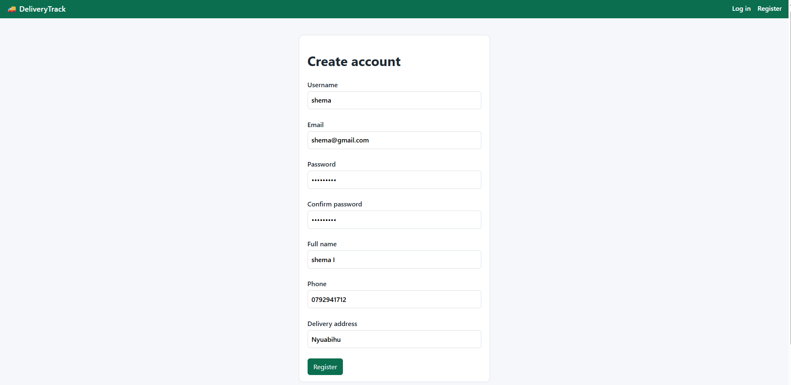 |

| T02 | Failure | Registration validation | Submit weak password `abc`, mismatched confirm, bad phone | Client-side errors appear; with JS disabled, server returns same errors; no DB rows added | 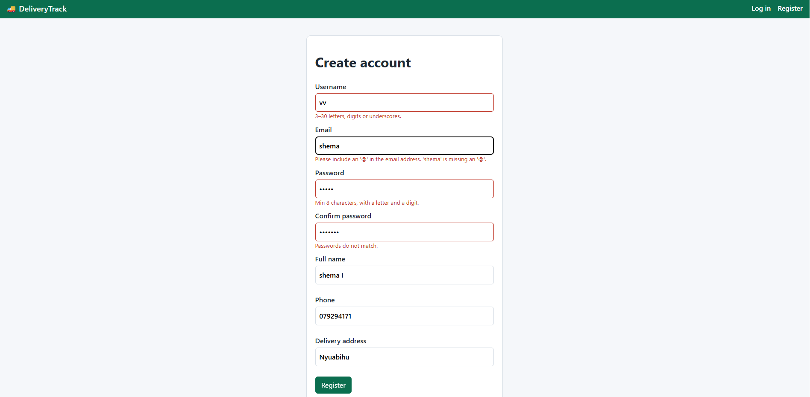|

| T03 | Failure | Duplicate user | Register with existing username | "Username or email is already taken." | 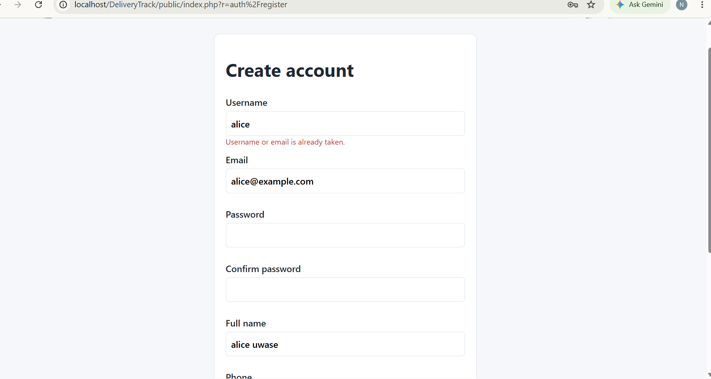|

| T04 | Happy | Login | | Redirect to dashboard, welcome flash, session ID regenerated |[TC](docs/test04.png) |

| T05 | Failure | Login | | "Invalid username/email or password."; no session | |

| T06 | Happy | Place order (customer) | As `alice`: New order → "Tea & bread", 9.50 | Order saved as `pending`, shown on tracking page | [TC](docs/test05.png)|

| T07 | Failure | Order validation | Total `-5` or details `ab` | Rejected client-side and server-side with messages |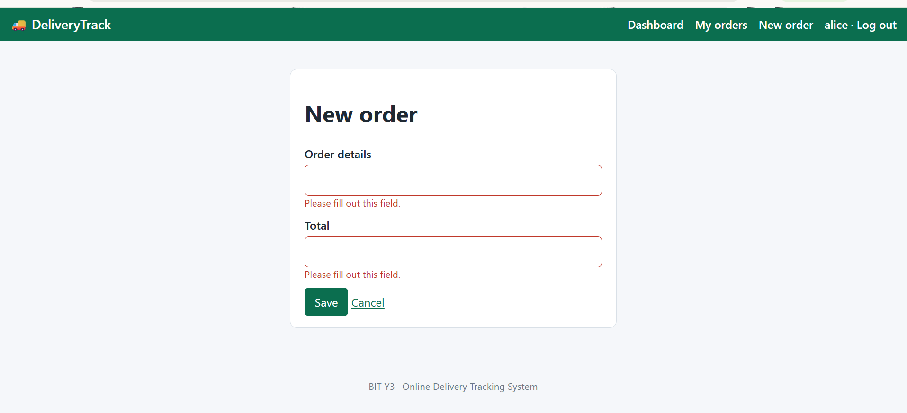 |

| T08 | Happy | Assign rider (admin) | As `admin`: Deliveries → Assign → pending order + `rider_james` | `deliveries` row created; order status → `assigned` |[TC](docs/test08.png) |

| T09 | Happy | Rider updates status | As `rider_james`: Mark picked up, then Mark delivered | `picked_at` / `delivered_at` set; order → `in_transit` → `delivered`; timeline updates for customer |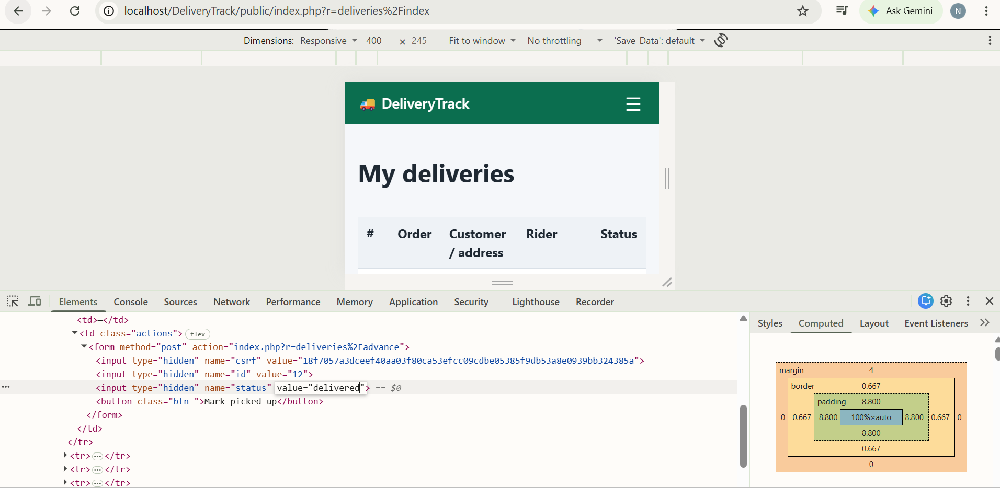 |

| T10 | Failure | Invalid status jump | Rider POSTs `status=delivered` for an `assigned` delivery (edit hidden field) | "Invalid status change."; no DB change | |

| T11 | Failure | CSRF | Remove/alter hidden `csrf` field on any form, submit | HTTP 419 "Invalid or missing CSRF token." |! [TC](docs/test11.png)|

| T12 | Failure | Authorization | As `alice`, open `?r=customers/index`; open another customer's order `?r=orders/show&id=3` | 403 for admin page; 404 for someone else's order |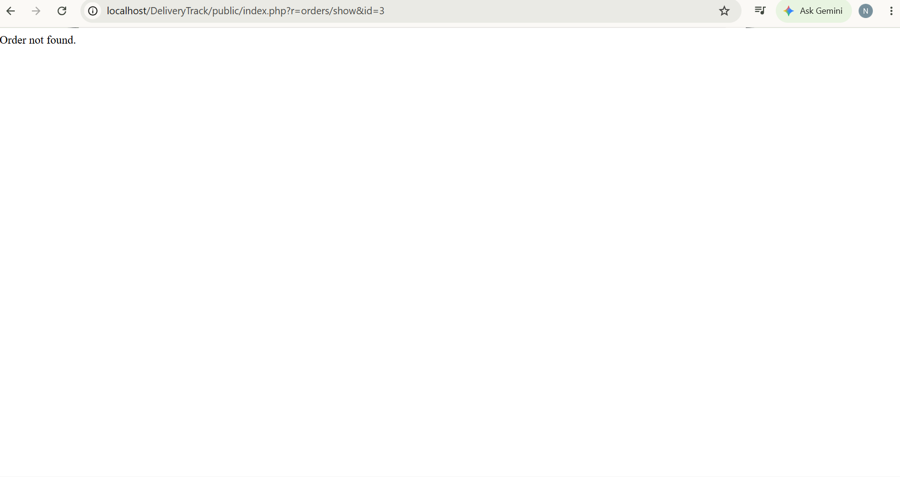 |

| T13 | Happy | Admin CRUD | Create, edit, delete a customer, an order, a user, a delivery | Each operation succeeds and is reflected in DB | 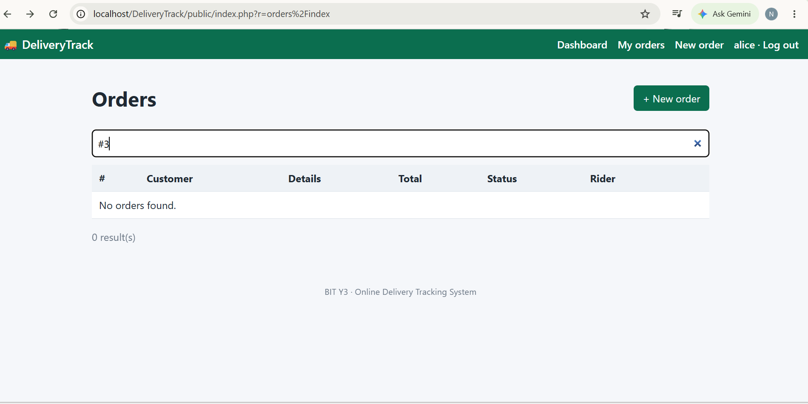|

| T14 | Happy | Live search API | On Orders page type `pizza`; also open `?r=api/orders&q=pizza` | Table filters without reload; JSON `{count,data}`; logged-out request returns 401 JSON | 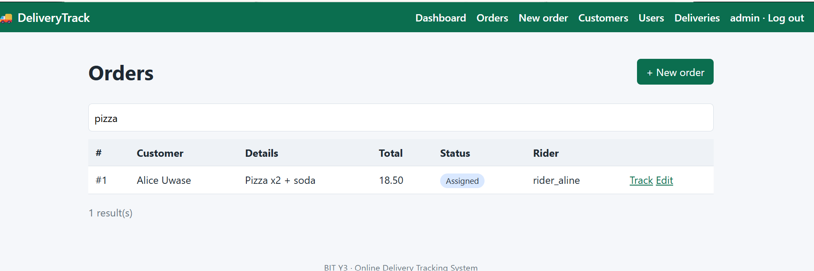|

| T15 | Failure | XSS | Create order details `` | Displayed as literal text everywhere (page and live search); no alert | 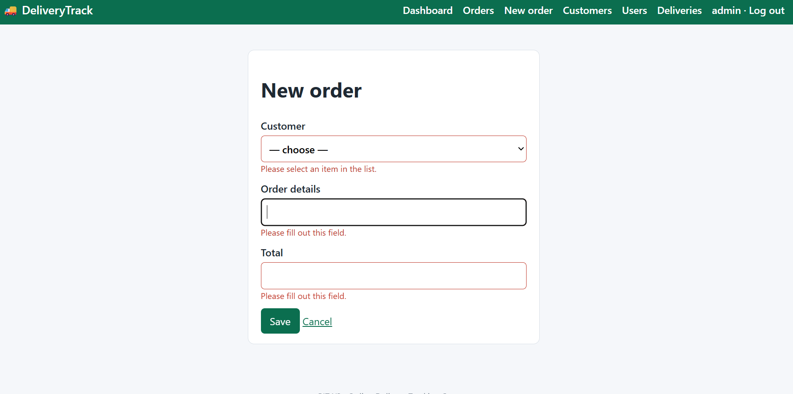|

| T16 | Failure | SQL injection | Search `' OR 1=1 --` | Zero/normal results, no error (prepared statements) |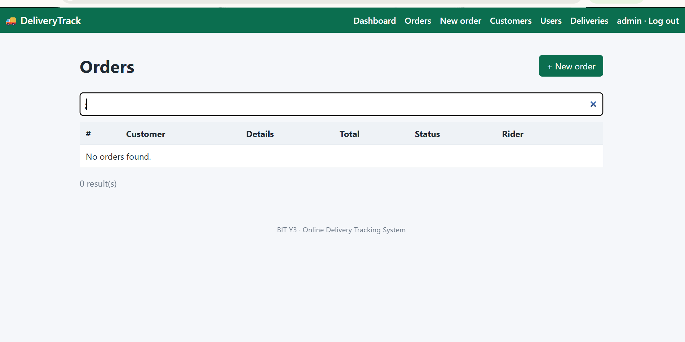 |

| T17 | Failure | Delete rider with deliveries | Admin deletes `rider_james` | Friendly error; FK `RESTRICT` protects data | 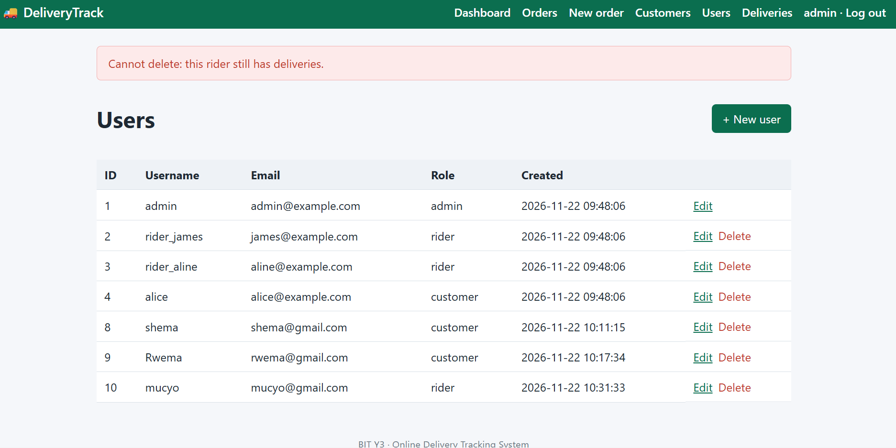|
